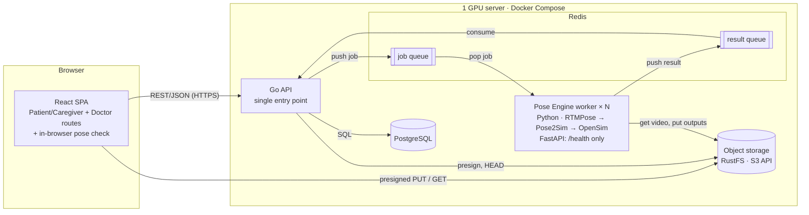

# Architect
This chapter is divided into 4 views
[Anti-Slop: 90% - @wachi - ALL HEAVY Reviewed by Wachi]

## System Architecture
[Anti-Slop: 90% - @wachi - Reviewed by DeepAung]

[Anti-Slop Indicator: 70% - Reviewed by DeepAung]
### Services

| Service | Tech | Job | Owns state |
|---|---|---|---|
| Frontend | React + Vite + shadcn/ui | One app; role routes `/patient/*`, `/doctor/*`. Live pose check before/during recording | — |
| API | Go (Chi + Huma) | Only public entry point: auth, accounts, records, clinical rules, job dispatch | Yes (PostgreSQL) |
| Database | PostgreSQL | Accounts, patients, recordings, job status, metrics | Yes |
| Object storage | RustFS (S3-compatible) | Raw videos, calibration files, keypoints, `.trc`/`.mot`, overlay videos | Yes (files) |
| Queue | Redis | Job queue (API → worker), result queue (worker → API). Work queue: 1 message → 1 consumer | transient |
| Pose Engine | Python | Stateless worker: pull job → process → push result. Small FastAPI for health checks only | No |

### Communication

| From → To | How | Carries |
|---|---|---|
| Frontend → API | REST/JSON, session cookie | Everything except video bytes |
| Frontend ↔ Object storage | Presigned URL (temporary link, 1 file, 1 action) | Video upload; doctor replay |
| API → Redis job queue | Push | Small job: recording id, video keys (count = camera count), calibration key, patient height + weight |
| Worker ↔ Object storage | S3 API | Download video, upload outputs |
| Worker → Redis result queue | Push | Metrics + output file keys, or error |
| Frontend → API | Polling every few seconds | Job status `processing → done / failed` |

### Recording lifecycle

1. Frontend asks API for upload links → API returns presigned PUT URLs.
2. Frontend uploads video(s) straight to object storage.
3. Frontend reports "upload done" → API checks files (`HEAD`), inserts recording (`processing`), pushes job.
4. A free worker pops the job, downloads video, runs the pipeline, uploads outputs, pushes result.
5. API consumes result → applies clinical rules (versioned config) → stores metrics, sets `done`.
6. Frontend polling sees `done` → shows results; video replay via presigned GET.

### Two pipeline modes

Pipeline depends on camera count, not location.

| | 1 camera | 2+ cameras |
|---|---|---|
| Where | Home | Home (optional 2nd camera) · Hospital |
| Worker pipeline | RTMPose 2D → reps, timing, 2D joint angles | RTMPose → Pose2Sim 3D → OpenSim angles, ROM |
| Output | Coarse data + 2D angles (labeled 2D) | 3D biomechanics for doctor's progress view |

### Note
[Anti-Slop: 70% - @wachi - Maybe important]
- **One source of truth for keypoints** \
    measurement numbers come only from server RTMPose. The in-browser model is a quality gate (lighting, framing, extra person), never stored as a result.
- **Claim-check:** \ 
    Redis carries keys, not video bytes.
- **Pose Engine never touches PostgreSQL** \
    only the API writes clinical data.

### Open decisions : question and options below

- **Object storage product** \
    RustFS (current) or another S3-compatible store
- **Redis queue type** (both survive a worker crash) \
    Streams + consumer groups, or list + `LMOVE`
- **Browser pose-check model** (owner: Dobby) \
    MediaPipe, or RTMPose via onnxruntime-web
- **Home camera setup** (owner: GAn) \
    1 or 2 cameras at home? Calibrate at home or not? \
    Affects: "Two pipeline modes" table and the "2nd camera?" branch in User workflow
- **Clinical scoring location** \
    Go `usecases/` (current), or a separate scoring service
- **Calibration reuse** (owner: GAn) \
    Lens calibration reused per camera; camera-space calibration redone every session? GAn to verify
- **Fine-tuned RTMPose weights location** (owner: DeepAung) \
    Object storage, baked into Docker image, or shared folder on server

## Project Directory
[Anti-Slop: 60% - @wachi - Agile, modify later]
```text
├── docker-compose.yml          # All services on 1 GPU server: frontend, api, postgres, redis, object storage, pose-engine
├── .env.example                # Required env vars (no secrets)
├── config/
│   └── clinical/               # Versioned cutoffs + MDC/MCID (e.g. AWGS_2025_v1.yaml); read by the scoring layer
├── docs/
│   ├── architect.md            # This file
│   ├── clinical-rules.md       # Clinical guardrails
│   └── wireframes/             # Standalone POC screens & UI rules (see docs/wireframes/AGENTS.md)
├── research/                   # Offline Pose2Sim & OpenSim experiments (never imported by backend)
├── paper/                      # Project paper (Typst source)
├── frontend/                   # React + TypeScript + Vite + Tailwind (shadcn/ui)
│   └── src/
│       ├── components/ui/      # Reusable shadcn/ui primitives
│       ├── pose-check/         # In-browser live check (quality gate only)
│       └── pages/
│           ├── patient/        # Patient / caregiver routes (large-font UI)
│           └── doctor/         # Doctor routes
└── backend/
    ├── api/                    # Go API, single entry point (Chi + Huma)
    │   ├── cmd/api/            # Application entrypoint
    │   └── internal/
    │       ├── handlers/       # Layer 1: HTTP transport (validate input -> call usecase -> return JSON)
    │       ├── usecases/       # Layer 2: Business logic & clinical scoring
    │       ├── repositories/   # Layer 3: PostgreSQL queries
    │       ├── gateways/       # Layer 4: Outbound clients (Redis queues, object storage)
    │       └── models/         # Domain & DTO structs
    └── pose-engine/            # Python worker (RTMPose, Pose2Sim, OpenSim); stateless
        └── app/                # Job loop + FastAPI /health
```

**Layer rules** (`handlers` → `usecases` → `repositories` / `gateways`)

| Layer | Does | Never |
|---|---|---|
| `handlers/` | Validate input → call usecase → return JSON | SQL, clinical cutoff math |
| `usecases/` | Business & clinical logic; orchestrates repos + gateways | HTTP details |
| `repositories/` | Database queries | Business rules |
| `gateways/` | Talk to Redis + object storage | Business rules |
| `pose-engine/` | Pose estimation, 3D kinematics, raw metrics | Touch PostgreSQL, clinical judgement |

## Data pipeline
[Anti-Slop: 60% - @wachi - just change model]

Toggle Pan mode to drag and view entire flow


```mermaid
%%{init: {"flowchart": {"useMaxWidth": false}}}%%
flowchart LR
    subgraph LIVE["Patient's device"]
        PRE{"Keypoint guard<br/>lighting, framing,<br/>one person"} -- fail --> PRE
        PRE -- pass --> CAM["Record 2 cameras<br/>guard keeps warning"]
        CAM --> UP["Upload via<br/>presigned URL"]
    end

    MRIT(["MRI team"])
    API["Go API"]
    OBJ[("Object storage")]
    JQ[["Redis<br/>job queue"]]

    UP -- video --> OBJ
    MRIT -. "manifest JSON<br/>(optional)" .-> OBJ
    UP -- "upload done" --> API
    API -- "check file, push job:<br/>id, video keys, calibration key,<br/>manifest key, height, weight" --> JQ
    JQ --> S

    subgraph WK["Pose Engine worker"]
        S["Sync"] --> K["RTMPose 2D<br/>per camera"] --> T["Triangulate + filter<br/>Pose2Sim"]
        T --> AUG["Marker augmentation<br/>LSTM"] --> SC["Scale Lai-Uhlrich<br/>height/weight or MRI bones"]
        SC --> IK["Inverse kinematics"]
        SC --> FM["Set Fmax<br/>from MRI"]
        IK --> GRF["GRF<br/>contact-sphere tracking sim"]
        FM --> GRF
        GRF --> MF["Muscle forces"] --> DCR["DCR per muscle"]
        IK --> MET["Metrics"]
        DCR --> MET
    end

    OBJ -. "videos, calibration, manifest" .-> S
    WK -. "upload .trc, .osim, .mot,<br/>muscle outputs, overlay" .-> OBJ
    MET --> RQ[["Redis<br/>result queue"]]
    RQ --> API
    API -- "clinical scoring" --> DB[("PostgreSQL")]
```

[Anti-Slop: 70% - @wachi - probably, LGTM]
### Models (input → output)

| Step | Model / tool | Input | Output |
|---|---|---|---|
| 0 | **Light pose model**, on device (see Open decisions) | Camera stream | Keypoints on device → pass / warning. Not stored |
| 1 | **RTMPose** (fine-tuned, HALPE_26: body + feet) | Video frames, per camera | 26 2D keypoints + confidence per frame |
| 2 | **Pose2Sim triangulation** + Butterworth filter | 2D keypoints ×2, calibration, synced frames | 3D keypoints `.trc` |
| 1–2 (1 cam) | **WHAM / SMPL** monocular 3D | Video frames, one camera | 3D joints → step 3 |
| 3 | **Marker augmenter** (OpenCap LSTM, built into Pose2Sim) | ~20 3D keypoints, height, weight | ~43 anatomical markers `.trc` |
| 4 | **Lai-Uhlrich model** + OpenSim Scale tool | Generic `.osim`, markers, height + weight or MRI bone lengths | Scaled `.osim` |
| 5 | **OpenSim IK** | Scaled `.osim`, markers `.trc` | Joint angles `.mot` |
| 6 | **Fmax script** | Scaled `.osim`, MRI manifest (skipped if none) | `.osim` with personal muscle strength |
| 7 | **GRF tracking sim** (`opencap-processing`, contact spheres) | `.mot`, personal `.osim` | Ground reaction force + muscle forces |
| 8 | **DCR script** | Muscle forces, Fmax | Demand-to-capacity ratio per muscle; near 1 = limiting muscle |
| 9 | **Metrics** (numpy/scipy) | `.mot`, DCR | Reps, times, joint angles, ROM, compensation flags, peak DCR. No clinical judgement |

Fmax (step 6), $\sigma_0 \approx 60$ N/cm², $\theta$ = pennation angle from literature:

$$F^{\max}_m = \sigma_0 \cdot \frac{V_m \cos\theta_m}{L^{\mathrm{opt}}_m} \cdot (1 - \mathrm{FF}_m)$$

### Data storage
[Anti-Slop: 30% - @wachi - dont know whether this is true]
| Data | Written by | Stored at | Read by |
|---|---|---|---|
| Live keypoints | Device | Not stored | — |
| Raw video | Browser | `recordings/{id}/raw/` | Worker; doctor replay |
| Calibration | Camera rig setup (GAn) | `calibration/{rig id}/` | Worker |
| MRI manifest | MRI team | `mri/{patient id}/manifest.json` | Worker (steps 4, 6) |
| 2D keypoints | Worker | `recordings/{id}/keypoints/` | Debug only |
| 3D + augmented markers `.trc` | Worker | `recordings/{id}/pose3d/` | Step 5 |
| Scaled + personal `.osim` | Worker | `recordings/{id}/model/` | Doctor 3D view |
| Joint angles `.mot` | Worker | `recordings/{id}/kinematics/` | Doctor 3D view + graphs |
| GRF, muscle forces, DCR | Worker | `recordings/{id}/muscle/` | Doctor muscle view |
| Overlay video | Worker | `recordings/{id}/overlay.mp4` | Doctor replay |
| Metrics + peak DCR | Worker → result queue → API | PostgreSQL | Patient result; doctor progress view |

### Constraints

- **Timestamp sync needs one shared clock.** \
    for 2 separate phones drift (1 frame = 33 ms at 30 fps) need careful design + maybe 1 tap record. Leave it to Dobby and GAn for frontend & camera
- **MRI manifest is optional.** Without it: scale by height + weight, generic Fmax.
- **MRI ≠ OpenSim:** one MRI muscle label may map to several OpenSim muscles; MRI is scanned supine and must be registered to OpenSim body frames.
- **GRF sim is slow** (minutes per trial). Built and tested first in `research/`, then moved into `pose-engine/`.
- **Plausible motion ≠ correct muscle force:** DCR is validated against dynamometer torque and EMG timing, not by eye.
- **1 camera = monocular, lower accuracy.** WHAM / SMPL replaces steps 1–2, then the same chain to DCR. Results flagged lower accuracy.

## User workflow
[Anti-Slop: 50% - @wachi - About to change after paper submission]
Toggle Pan mode to drag and view entire flow


```mermaid
%%{init: {"flowchart": {"useMaxWidth": false}}}%%
flowchart LR
    REG(["Register<br/>basic info"]) --> WHERE{"Record Location"}

    subgraph HOME["Patient · Home"]
        H1{"Is caregiver present?"}
        H1 -- no --> H2a["Easy poses only"]
        H1 -- yes --> H2b["Easy + medium poses"]
        H2a --> H3["Pick pose<br/>free + system suggestion"]
        H2b --> H3
        H3 --> H4{"2nd camera?"}
        H4 -- no --> H5a["Set up 1 camera<br/>default calibration"]
        H4 -- yes --> H5b["Set up 2 cameras<br/>calibrate cameras together"]
        H5a --> H5["Record<br/>live pose check"]
        H5b --> H5
        H5 --> H6["Processing…<br/>then coarse data"]
        H6 --> NEW{"Is new patient?"}
        NEW -- yes --> H7["See-a-doctor probability<br/>+ confidence %"]
        NEW -- no --> H8["Doctor's appointment<br/>or urgent risk alert"]
    end

    subgraph HOSP["Patient · Hospital (nurse assists)"]
        P1["Measure with tools<br/>e.g. handgrip<br/>lens calibration: once per camera"] --> P2["Set up 2+ cameras"]
        P2 --> P3["Record hard / risky poses<br/>per doctor's advice<br/>e.g. TUG, 5STS, SPPB<br/>live pose check"]
        MRI["MRI muscle data (optional)<br/>doctor uploads → MRI team<br/>→ manifest back"]
    end

    WHERE -- home --> H1
    WHERE -- hospital --> P1
    H5 --> REC[("Patient records")]
    P3 --> REC
    MRI -.-> REC

    subgraph DOC["Doctor"]
        D1["Browse patients"] --> D2["Select record<br/>date, pose"]
        D2 --> D3["Progress view"]
        D3 --> D4["Assign / adjust<br/>task-specific treatment program"]
        CLS["Platform classification<br/>helps diagnosis"] -.-> D4
        D4 --> D5{"Next step"}
    end

    REC --> D1
    H7 -- "patient decides" --> P1
    H8 -- "appointment date<br/>or high risk" --> P1
    D5 -- "feedback + home program" --> H1
    D5 -- appointment --> P1
```

### Roles and pose tiers
[Anti-Slop: 70% - @wachi - Reviewed by Wachi]
**Roles**
- **Patient / caregiver**: registers, records at home, sees coarse results (large-font UI)
- **Nurse**: helps the patient use the patient screens at hospital, e.g. typing handgrip / BIA values
- **Doctor**: browses patients, reviews progress, assigns treatment programs, gives feedback, uploads MRI scans (optional, few patients)
- **Dev team**: creates accounts (no admin UI)

**Pose tiers** (patient picks freely within unlocked tiers; system suggests poses, e.g. from doctor's program)
- **Easy**: home, always unlocked
- **Medium**: home, unlocked only when a caregiver is present
- **Hard / risky**: unlocked by choosing "Hospital" at the start screen, on doctor's advice, nurse assists

### Results by role

**Patient: home result**
- After processing: coarse data (e.g. reps, time, 2D angle).
- New patient (first registration): **see-a-doctor probability + confidence %**, a guard before seeing a doctor.
- Existing patient: doctor's appointment, or an **urgent risk level** when a hospital check-up is needed soon.
- Wording is a referral suggestion, never a diagnosis.

**Patient: from doctor**
- In-app only: feedback, home program, appointment (date + note). No LINE / SMS.
- Full appointment booking (slots, confirm, reschedule) is a later feature.

**Doctor: progress view**
- Joint angle graph + ROM vs standard (2D for 1-camera, 3D for 2+ camera recordings)
- 3D model from keypoints + OpenSim (2+ camera recordings)
- Video replay with skeleton overlay
- Optional: muscle mass & function per pose, e.g. before/after medication
- Warning indicator when the patient **tenses up (เกร็ง) or compensates**, since the numbers alone may look normal
- Change shown against MDC band (see [clinical-rules.md](clinical-rules.md))
- Platform classification supports the doctor; it never labels sarcopenia

### Classification model

- **One engine, two views:** patient sees a plain referral / risk level; doctor sees the same score with its inputs and reasons
- **v1:** rule-based score + fuzzy logic for confidence %, rules from the versioned config
- **Later phase:** ML model
  - Collect data continuously from every recording
  - Candidate targets: see-a-doctor referral, defect detection
  - Multimodal inputs: pose metrics + handgrip + muscle data

### Open decisions

- **Tensing / compensation rules** \
    Joints and thresholds, decided per pose
- **Pose list per tier** \
    Which poses are easy / medium / hard
- **Consent for research / ML data** (ask professor + ethics committee) \
    Separate care vs research consent, or one combined consent
- **MRI hand-off** \
    How uploaded scans reach the MRI team and how the manifest comes back
